# Wazuh SIEM Home Lab: Detecting Brute Force, Persistence, Privilege Escalation and File Tampering

A hands-on Security Operations (SOC) lab built on a MacBook (Apple Silicon) with UTM virtual machines. A **Wazuh SIEM** monitors a **Kali Linux** endpoint. I simulated common attacker behaviour, investigated the alerts, mapped them to **MITRE ATT&CK**, and wrote a **custom detection rule**.

  

---

## 1. Objectives
- Deploy an all-in-one Wazuh SIEM (manager, indexer, dashboard).
- Onboard a Linux endpoint with the Wazuh agent.
- Simulate attacker techniques and confirm they are detected.
- Configure real-time **File Integrity Monitoring (FIM)**.
- Tune detection with a **custom rule** mapped to MITRE ATT&CK.
- Review the endpoint's security posture with **Security Configuration Assessment (SCA)**.

## 2. Architecture

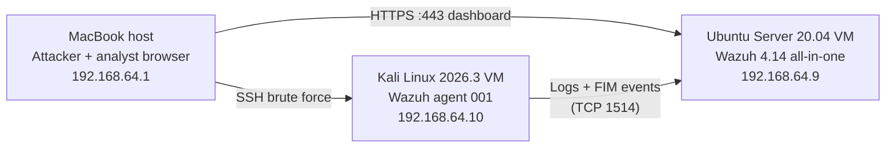

| Component | Details |
|---|---|
| Hypervisor | UTM (QEMU, ARM64) on macOS |
| Wazuh server | Ubuntu Server 20.04, 4 vCPU, 6 GB RAM, 60 GB disk, Wazuh 4.14.10 (manager, indexer, dashboard) |
| Monitored endpoint | Kali Linux 2026.3 (ARM64), 4 vCPU, 4 GB RAM, Wazuh agent 4.14.10 |
| Attacker | macOS host on the same UTM shared network |

## 3. Build summary
1. **Wazuh server:** ran the all-in-one installer on Ubuntu (`wazuh-install.sh -a`) and accessed the dashboard over HTTPS.
2. **Agent onboarding:** used *Deploy new agent* (DEB aarch64) on Kali and confirmed the agent was **Active**.
3. **Log source fix:** installed `rsyslog` on Kali so `/var/log/auth.log` exists for SSH log collection.
4. **FIM:** added a real-time monitored directory to the agent's `<syscheck>` config ([configs/ossec-syscheck-snippet.xml](configs/ossec-syscheck-snippet.xml)).
5. **Custom rule:** added rule `100010` to the manager ([configs/local_rules.xml](configs/local_rules.xml)).

Full commands: [scripts/install-notes.md](scripts/install-notes.md)

## 4. Attack simulation and detections
Simulation steps: [scripts/simulate-attacks.sh](scripts/simulate-attacks.sh)

| # | Technique simulated | Action | Wazuh rule(s) triggered | Level | MITRE ATT&CK |
|---|---|---|---|---|---|
| 1 | SSH brute force | Repeated `ssh fakeuser@kali` with wrong passwords from the Mac | 5710 non-existent user · 5503 PAM login failed · 2502 multiple password failures · **5712 brute force** | 5 → **10** | T1110 Brute Force |
| 2 | Persistence | `useradd hacker` | 5902 new user added · 5901 new group added | 8 | T1136 Create Account |
| 3 | Defense evasion / cleanup | `userdel hacker` | 5903 user/group deleted | 3 | — |
| 4 | Privilege escalation | `sudo su` | 5402 successful sudo to ROOT | 3 | T1548.003 Sudo |
| 5 | File tampering (FIM) | Create, modify, chmod 777, delete `payroll.txt` | 554 added · 550 checksum/permissions changed · 553 deleted | 5–7 | — |
| 6 | Custom detection | Fake-user SSH from the known attacker IP | **100010 (custom)** | **10** | T1110 Brute Force |

### Key observations
- **Correlation reduces noise:** single failed logins are low severity (level 5). Wazuh correlated repeated failures into one **level 10 brute-force alert (5712)**, which is the alert an analyst should act on.
- **Context matters:** `sudo` to root is only level 3 because admins use it daily. Account creation is level 8 because it is a common persistence technique.
- **FIM proves tampering:** the modified-file alert recorded the old and new **MD5/SHA-1/SHA-256 checksums** and the permission change (to 777) on the monitored file.
- **Timing matters for FIM:** changing and deleting a file within the same second produced only a *deleted* event, so the test was repeated with pauses.

## 5. Custom detection rule
```xml
<group name="local,sshd,">
  <rule id="100010" level="10">
    <if_sid>5710</if_sid>
    <srcip>192.168.64.1</srcip>
    <description>LAB: SSH login attempt with fake user from known attacker machine</description>
    <mitre><id>T1110</id></mitre>
  </rule>
</group>
```
**Why:** the default rule 5710 is level 5. This child rule escalates the same event to **level 10** when it comes from a known attacker IP and tags it with T1110. The same approach applies in production for threat-intelligence IPs or critical assets.

## 6. Security Configuration Assessment (bonus finding)
Wazuh SCA scanned Kali against the **CIS Distribution Independent Linux Benchmark v2.0.0**:

| Passed | Failed | Not applicable | Score |
|---|---|---|---|
| 83 | 98 | 9 | **45%** |

A default Kali build is not hardened for production use. The failed checks are a ready-made remediation list.

## 7. Incident response (if this were a real alert)
For the brute-force alert (5712 / 100010):
1. **Validate:** was any login successful from the same `srcip` after the failures?
2. **Contain:** block the source IP (firewall or Wazuh active response) and disable password SSH login.
3. **Investigate:** check other hosts for the same source IP, and any new accounts (5902) or sudo use (5402) around the same time.
4. **Recover and harden:** reset affected credentials, enforce key-based SSH and fail2ban, and apply the CIS hardening items.
5. **Document** the timeline, IOCs (source IP, usernames tried) and actions taken.

## 8. Troubleshooting log (lessons learned)
| Problem | Cause | Fix |
|---|---|---|
| Kali installer showed a black screen or "Display output is not active" in UTM | ARM64 installer outputs to the serial console | Added a Serial device in UTM, installed through it, then switched the display back to `virtio-gpu-pci` |
| Wazuh dashboard install failed and rolled back | `No space left on device`: Ubuntu's LVM used only 30 of 60 GB | `lvextend -l +100%FREE -r /dev/ubuntu-vg/ubuntu-lv`, then reinstalled with `-o` |
| Wazuh server slow or unstable | VM had 3.8 GB RAM | Increased to 6 GB / 4 vCPU |
| No SSH events from Kali | `/var/log/auth.log` missing (journald only) | Installed and enabled `rsyslog` |
| FIM showed only "deleted" | File changed and deleted within one second | Repeated the test with 15-second pauses |

## 9. Screenshots
| | |
|---|---|
| Dashboard overview | 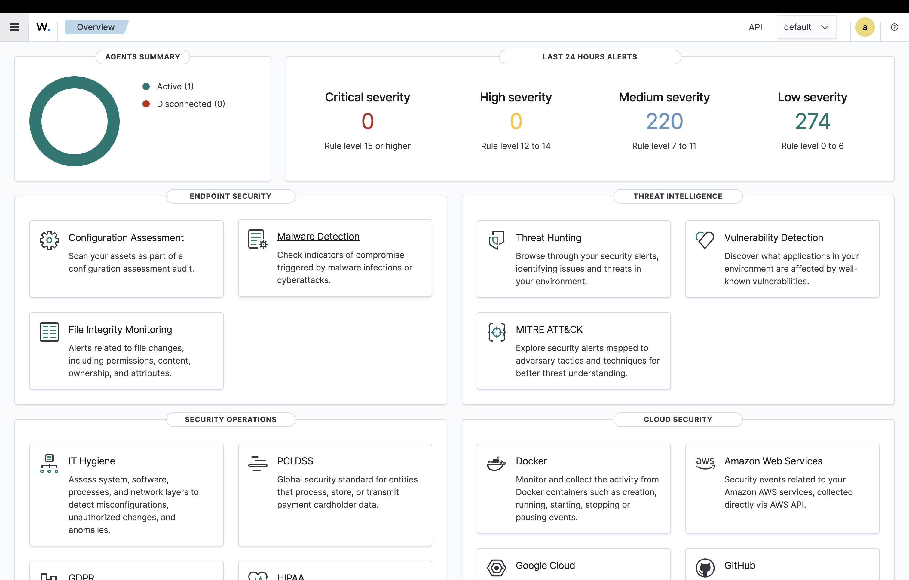 |
| Agent active (Kali 001) | 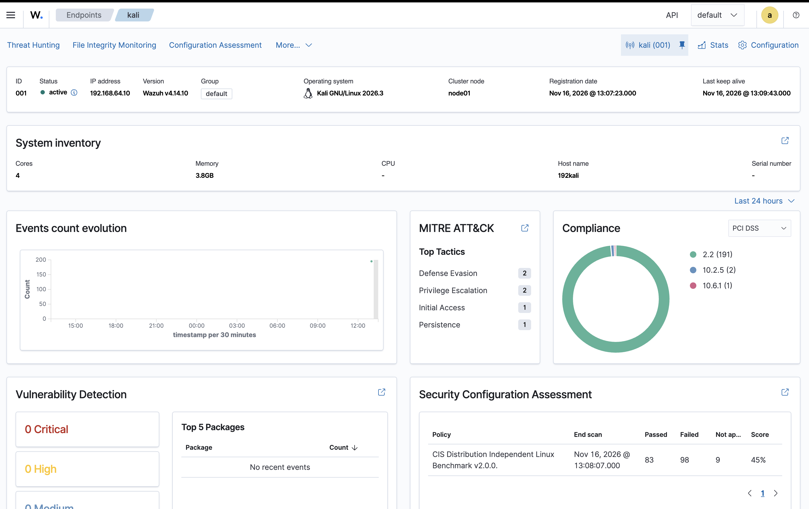 |
| SSH brute-force alerts (5710 / 5712) | 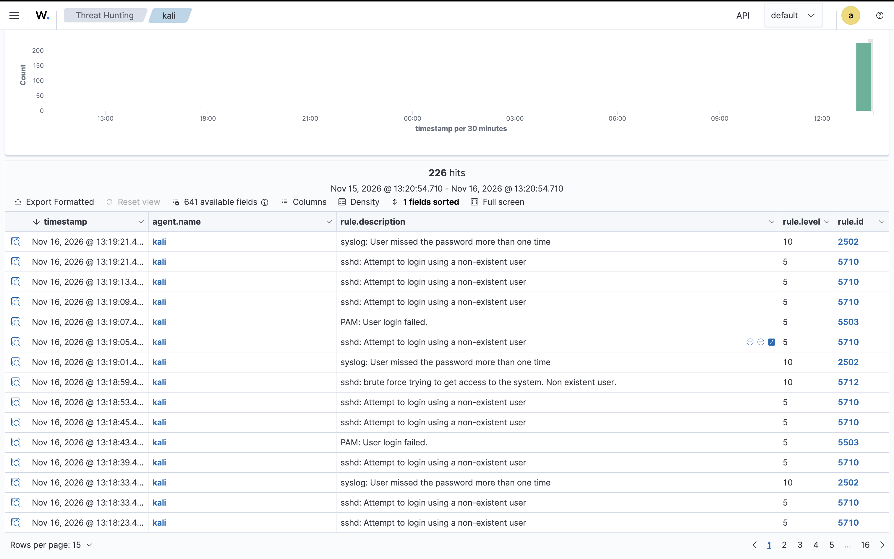 |
| Brute-force alert details (srcip, MITRE) | 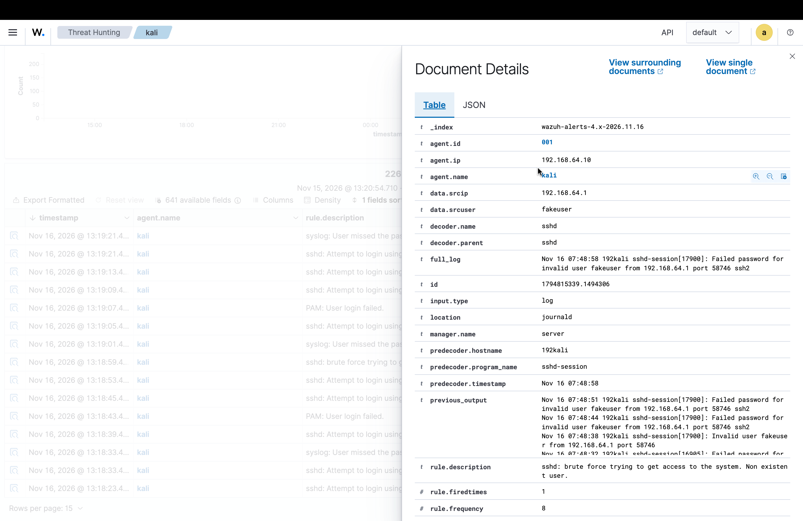 |
| New user / sudo to root (5902 / 5402) | 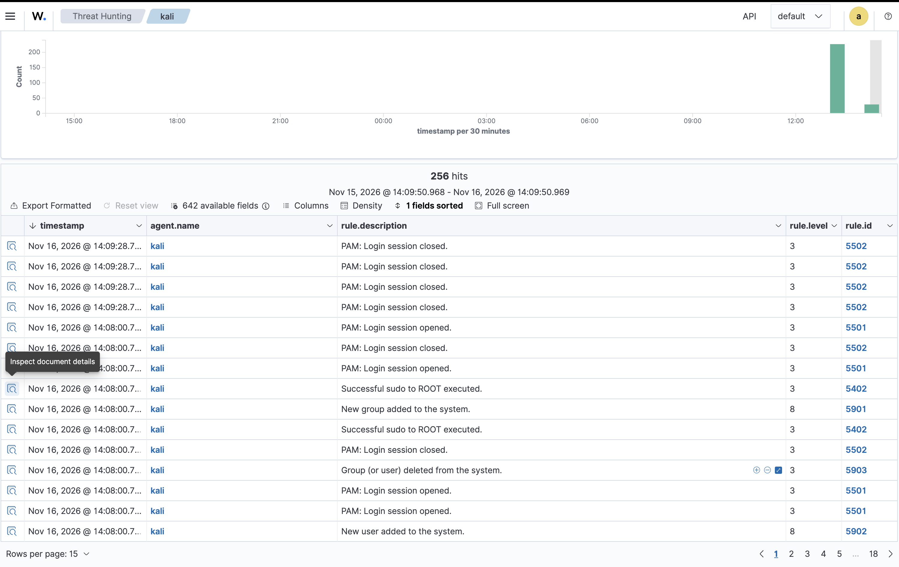 |
| FIM events (554 / 550 / 553) | 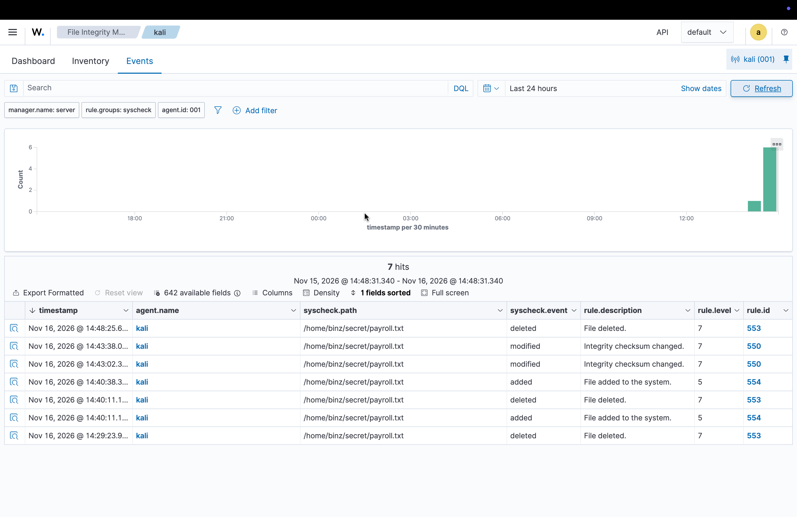 |
| FIM checksum-change details | 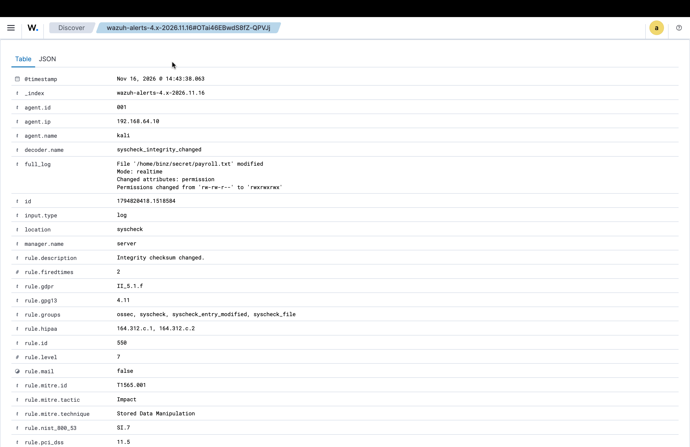 |
| Custom rule 100010 firing | 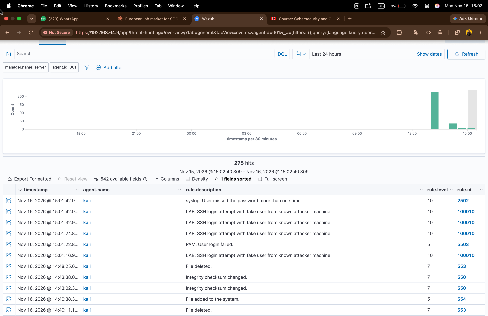 |
| MITRE ATT&CK view | 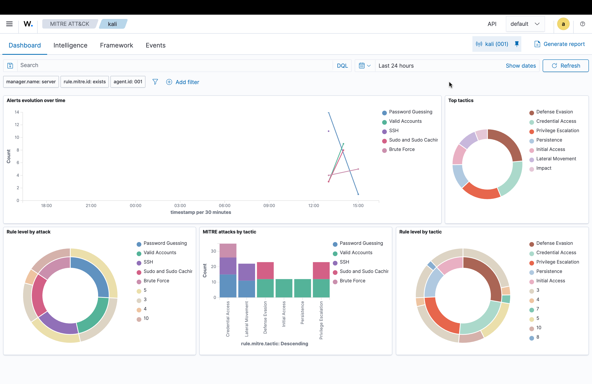 |
| SCA CIS benchmark result | 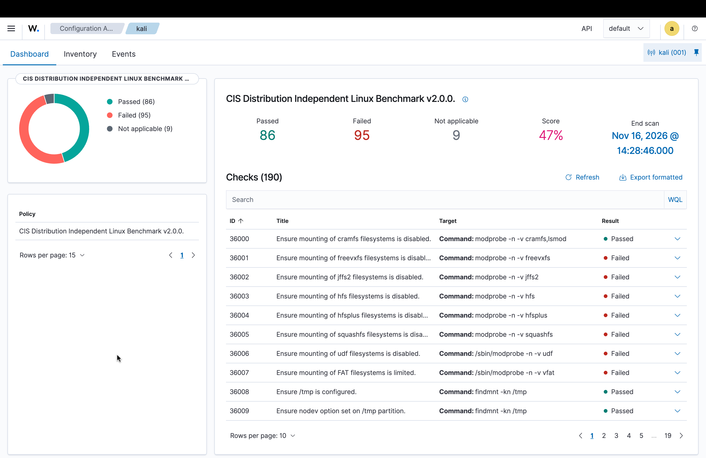 |

## 10. Skills demonstrated
SIEM deployment and administration · log collection and agent management · alert triage and severity analysis · detection engineering (custom rules) · File Integrity Monitoring · MITRE ATT&CK mapping · CIS benchmark assessment · Linux administration · virtualisation (UTM/QEMU ARM64) · troubleshooting


> All activity was performed in an isolated personal lab. IP addresses are private lab addresses. No credentials are included in this repository.
